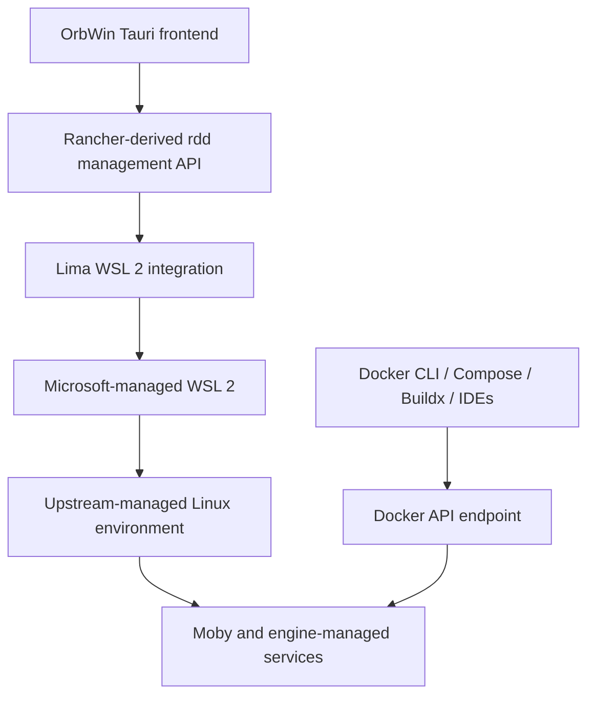

# OrbWin decisions and pending choices

Recorded: 2026-10-21, America/Los_Angeles.
Updated: 2026-10-22 with the user's implementation clarifications.

This is the durable record of the user's accepted direction. A candidate library
or implementation mentioned in research is not automatically an accepted
dependency. The project has entered early phase 1 implementation. Current build,
runtime evidence and unresolved gates are recorded in
[development progress](development-progress.md); no phase or release qualification
is implied by an intermediate proof.

## Product objective

Build a fast, dependable Windows Docker-development product with OrbStack-inspired
flows, interaction quality, and convenience. Improve reliability over Docker
Desktop where measurements and failure investigations justify that claim.
Performance improvements are welcome but must be measured. Rancher and WSL are
foundations to qualify, not evidence that those objectives are already achieved.

Kubernetes compatibility is a benefit and part of the intended direction.

The strongest initial workloads are Docker-dependent integration/CI-style tests
run by developers on Windows, including tests that launch Linux-only server/service
components. The user's limited first-hand experience is an actual Docker Desktop
crash during such a test, not a freeze. This is motivation, not evidence of a
specific root cause or a measured crash rate. General developer container and local
Kubernetes workflows remain in scope; niche workloads unrelated to Linux server
development are lower priority.

## Accepted decisions

| ID | Decision | Consequence |
| --- | --- | --- |
| D01 | Start by prototyping on Rancher Desktop 2.0 and grow with upstream. | Evaluate and reuse its standalone Go daemon, `rdd`, and its existing integration. Do not start a competing from-scratch backend. |
| D02 | Microsoft WSL 2 is the Windows virtualization foundation. | Use the selected upstream's Lima/WSL integration; no custom hypervisor, WSL replacement, kernel fork, or hardware-driver project. |
| D03 | Preserve Kubernetes compatibility. | Keep upstream capabilities and the management API. The optional workload cluster should be an explicit user choice, not a prerequisite for ordinary Docker use. |
| D04 | Use Tauri with an organized React/TypeScript frontend. | Keep the Rust desktop adapter thin; reuse Go for backend work. Favor existing tested code over language-driven rewrites. |
| D05 | Reproduce OrbStack's useful observable flows and convenience, adapted to Windows. | Product research produces evidence-backed behavioral specifications, not a portable copy of macOS internals. Use Windows conventions where necessary. |
| D06 | Every phase ends in a working, qualified product. | Phase boundaries are scope boundaries, not permission to defer correctness or ship broken supported workflows. |
| D07 | Important core code follows kernel-grade engineering discipline. | Explicit invariants, ownership, concurrency, errors, cancellation, crash recovery, security boundaries, and adversarial tests. See the quality standard. |
| D08 | The frontend uses design-system-led implementation. | Specify tokens, component states, interaction contracts, accessibility and visual validation before assembling inconsistent screens. No Figma dependency is required. |
| D09 | Reuse the real Docker ecosystem. | Use upstream Moby, Docker CLI, Compose, Buildx/BuildKit and engine-managed containerd/runc. Preserve standard Docker APIs and workflows. |
| D10 | Prefer reuse of appropriately licensed upstream components. | Rancher, Podman, Microsoft and OrbStack open-source components are candidates; preserve licenses, notices, provenance, tests and an upgrade path. |
| D11 | WSL networking is sufficient initially. | Keep the selected backend's working networking integration; avoid a separate custom network-stack project or gratuitously stripping upstream networking. |
| D12 | Prefer Windows and WSL integration over repeated manual container configuration. | Reuse OS proxy, DNS, credential, certificate and filesystem mechanisms where supported. Do not promise that every application inside every image automatically honors host settings. |
| D13 | Engine guest distribution is internal packaging. | Preserve the selected upstream's base and init initially. Users can develop in Fedora, openSUSE, Ubuntu or other supported WSL distributions independently. |
| D14 | System/data virtual-disk arrangement is internal. | Preserve the chosen backend's arrangement. Users need data safety, storage location and management capabilities, not an exposed disk-topology choice or two physical drives. |
| D15 | Support ordinary Windows-hosted and Linux-hosted development projects. | Include other local Windows drives, integrated user WSL distros, directory/file bind mounts, read-only mounts and Compose paths in the compatibility plan. Moving projects into Linux cannot be mandatory onboarding. |
| D16 | Preserve ordinary Docker capabilities within platform limits. | No blanket rootless requirement or arbitrary removal of standard flags. Linux root/privileged containers are distinct from Windows administrator access. |
| D17 | Use least-privileged host operation without limiting needed capabilities. | Normal per-user operation plus a narrow elevated helper when a specific host integration requires it. Backend lifecycle must survive closing the UI. |
| D18 | Initial OS target is supported Windows 11 desktop releases. | Include Home, Pro/Pro variants, Enterprise and Education. x64 is the initial architecture; additional architectures and older OS versions require qualification. |
| D19 | Reliability and performance comparisons are empirical. | Compare real workflows with Docker Desktop, the chosen Rancher baseline and, where helpful, plain WSL Docker. Never infer lower crash rates from a new UI. |
| D20 | Accept reasonable WSL limitations. | Do not force direct container-IP access, arbitrary layer-2 networking, global resource isolation or macOS-specific behavior through a large custom platform layer. |
| D21 | Use REA where supported for product research. | Assess available providers and artifacts; preserve evidence and uncertainty. Native macOS runtime observation needs a Mac. Public documentation research continues independently. |
| D22 | Research and decision recording proceed in parallel. | The new product-research chat begins with a self-contained brief and does not wait for these files. |
| D23 | Phase 1 is the full Rancher-backed, OrbStack-inspired developer UI. | Use proofs of concept and core journeys as milestones, not an artificial reduction of phase-exit scope. Map relevant researched flows and inherited capabilities; record backend blocks and any justified niche-feature exclusion. |
| D24 | Simultaneous coexistence is required. | OrbWin must coexist and run alongside Docker Desktop and Rancher Desktop with isolated owned resources and explicit client targeting. Verify endpoint, identity, storage, configuration and host-port interactions early; normal shared-port conflicts must fail clearly. |
| D25 | Reuse verified upstream migration capabilities; fill migration gaps in phase 2. | Do not assume shared backend ancestry makes state interchangeable, or that 1.x, 2.0 and OrbWin share migration support. Attaching to an explicitly selected compatible daemon and migrating persistent state are different operations. |
| D26 | Recovery starts from evidence-backed OrbStack behavior and its product principles. | For Windows/WSL-specific failures favor smooth, clean recovery where feasible; otherwise fail transparently and promptly. Never attribute an invented recovery branch to OrbStack. |
| D27 | Keep the Rancher relationship clean enough for frequent updates. | Pin dependencies, isolate version/API adaptation, minimize and document patches, and run upgrade/contract checks. Breaking upstream API changes are expected maintenance work, not grounds for freezing indefinitely or deeply forking. |
| D28 | Engineering owns completeness of reliability planning. | Seed coverage from Docker/container-development knowledge, upstream bug reports and public failure evidence, then expand using our own tests. Do not require the user to enumerate every requirement, failure mode or reproduction before proceeding. |
| D29 | Planning and measurement may precede implementation in every phase. | Autonomously order proofs, baselines and milestones to reduce rework; implement and test core journeys early, then complete the remaining phase scope. |
| D30 | Complete the ordinary product workflows before making the product installable. | User reaffirmed full phase 1 workflow coverage on 2026-10-22. Deliver an installer after implementation and qualification; automatic updates are not required yet. |

### Host testing authorization — 2026-10-22

The user reports Rancher Desktop and Rancher Desktop 2 are both installed and
authorizes using them for coexistence tests as needed. Inspect actual versions,
running state, endpoints and workloads before testing; installation alone is not
simultaneous-workload evidence. Preserve existing data and workloads. This does
not authorize reset, unregister, migration or global WSL shutdown.

Phase 1 reliability work reuses upstream lifecycle, engine, storage and networking
mechanisms. OrbWin owns safe integration, truthful readiness/progress/errors,
bounded operations and reconnects, scoped recovery and diagnostics, plus tests of
the supported product combination. Add narrow backend fixes only for demonstrated
gaps; do not build a second lifecycle supervisor or replace working upstream
mechanisms. Qualification is required even for inherited behavior. Measured
reliability/performance improvements remain phase 3 work, except fixes necessary
to satisfy phase 1 acceptance criteria.

## Architecture to prototype

Logical ownership:

- Microsoft owns the kernel and virtualization platform.
- The selected Rancher/Lima backend owns guest lifecycle and integration.
- Moby owns container, image, network and volume state. Do not manipulate its
  private storage or run a parallel containerd orchestrator beneath it.
- Upstream Compose owns Compose behavior. Parsing a Compose file is not equivalent
  to implementing orchestration.
- OrbWin owns the product UI, adaptations, convenience features and changes proven
  necessary by concrete backend limitations.
- Keep product management and Docker compatibility APIs distinct. Do not route
  Docker clients through the UI or make the UI authoritative for engine state.

## Pending implementation choices

| ID | Choice | Current direction | When and how to resolve |
| --- | --- | --- | --- |
| P01 | Exact Rancher 2.0 and Lima baseline | Pin a reproducible upstream commit/release; do not assume alpha quality is release quality. | Phase 1 entry: record versions, build/release method, API contracts and known limitations. |
| P02 | `rdd` reuse and extension boundary | Prefer using its API and narrowly scoped upstream-compatible changes. | Phase 1 spike: demonstrate lifecycle, Docker endpoint discovery and the required UI operations. |
| P03 | Backend-blocked UI flows | Adapt honestly in phase 1 and record deferred parity. | Research plus phase 1 implementation; maintain the blocker ledger with acceptance criteria. |
| P04 | Backend reliability and footprint | Unproven; preserve a baseline before changes. | Test throughout phase 1; deeper improvement work in phase 3. |
| P05 | Engine guest base/init | Inherit the selected upstream; Rancher 2.0 documentation describes openSUSE Leap. | Verify against the pinned baseline. Reconsider only for a measured compatibility, maintenance or footprint reason. |
| P06 | Physical virtual-disk layout | Inherit upstream rather than simplify or redesign immediately. | Inspect the chosen 2.0 backend; do not assume 1.x's layout applies. Set migration/data-preservation contracts before public data-bearing releases. |
| P07 | Storage relocation, backup and restore scope | User-facing capabilities matter more than disk topology. | Assess inherited functionality in phase 1; qualify safe supported operations before exposing them. |
| P08 | Default WSL sharing versus Microsoft VirtioFS | Evaluate promising Microsoft technology; keep a qualified fallback. | Bounded experiment: performance, notifications, symlinks, permissions, mounts, restart and recovery. Avoid maintaining unnecessary production modes. |
| P09 | Local domains and Windows resolver integration | Favor OS-supported mechanisms and minimal setup. | Phase 2 prototype: verify VPN/split-DNS, managed-device policy, privilege and conflict behavior. |
| P10 | HTTPS/reverse-proxy/CA implementation | Caddy/CertMagic are candidates, not yet committed dependencies. | Phase 2: evaluate service discovery, trust, key storage, port conflicts and lifecycle. |
| P11 | `securefs` versus Go `os.Root` | Prefer standard-library operations where adequate; Linux-root symlink semantics can justify securefs. | Resolve per actual file-access operation, with security tests; not a user-facing option. |
| P12 | REA execution path and Mac observation | Check actual providers, supported formats, target availability and allowed research methods. | Independent product-research chat; record observed, documented, inferred and unknown separately. |
| P13 | Compatibility certification matrix | Normal Docker workflows are required from phase 1; breadth expands later. | Set initial OS/WSL/backend/client versions in phase 1, widen in phase 4. |
| P14 | Additional architecture/OS support | ARM64, Windows 10, Server and specialized editions remain qualification targets. | Phase 4 or earlier only if justified by concrete demand and upstream support. |
| P15 | Native Windows containers, pre-login/headless service modes, device passthrough | Separate substantial capability decisions; no implied phase 1 commitment. | Phase 4 evaluation; distinguish platform availability from validated product support. |
| P16 | Packaging and distribution | Reuse build/installer patterns but own product identity and updates. | Phase 1: local reproducible build and runnable artifact; public distribution requires signing/update/data-path/coexistence decisions. |
| P17 | Exact performance and stability budgets | Compare workloads and distributions rather than inventing universal targets. | Establish baseline workloads in phase 1 and set explicit regression budgets before phase exit. |
| P18 | Simultaneous-engine isolation details | Required capability; prefer host endpoint/configuration adaptations over Moby changes. | Earliest phase 1 proof: independent identities, named pipes, Docker/Kubernetes contexts, WSL integration, data, management APIs, ports and start/stop ordering. |
| P19 | Migration capability by source product/version | Reuse what is actually verified; custom migration belongs to phase 2. | Inventory Docker Desktop, Rancher 1.x and Rancher 2.0 separately; distinguish project reuse, image transfer, volume/application backup and settings/cluster migration. |

## Coexistence and migration evidence

Read-only inspection of the upstream checkout at commit
`af6511ad4e065e24e7258f575a0fc090c10cdbda` found that
`rdd/pkg/socketbridge/host_windows.go` and `rdd/pkg/instance/instance.go` select
`\\.\pipe\docker_engine` for the Windows Docker endpoint. Instance suffixes
separate some directories and management resources but do not alone separate this
endpoint. This is source evidence, not a runtime coexistence result or the chosen
production pin. Check the selected version before adapting it.

Rancher Desktop's current general FAQ says Docker Desktop and Rancher Desktop can
be installed together but cannot run together. Its 2.0 installation article says
2.0 installs beside 1.x with separate package/data. Side-by-side installation does
not establish simultaneous runtime support or transfer of existing data. OrbWin's
simultaneous-operation requirement therefore needs explicit qualification.

The working hypothesis is that isolation can be implemented in host integration
without changing the Moby engine. Verify it rather than promising zero backend
changes. A distinct pipe must be used consistently by the bridge, endpoint
discovery and clients; a new Docker context alone cannot fix a shared listener.
Clients with implicit/default socket discovery, test frameworks and WSL socket
mounts also require testing. Do not silently steal another product's default
context, terminate its backend, or share a writable engine data disk.

No general automatic migration facility was verified in this review. Existing
Compose projects and registry images are different from live containers, named
volume data, credentials, app settings and Kubernetes state. Preserve and reuse
upstream migration operations where verified; qualify their source/target versions
and ownership semantics. A smooth transition from Rancher is a goal, not yet a
tested no-op. Additional migration work belongs in phase 2 and must not delay the
rest of phase 1.

## Earlier proposals superseded or qualified

- A new Go supervisor assembled from selected Rancher 1.x components is no longer
  the initial plan. Start with Rancher 2.0's standalone daemon.
- Debian/systemd was an initial independent-packaging proposal, not a user-facing
  compatibility requirement. Preserve upstream packaging when starting from Rancher.
- A custom JSON-RPC management protocol is unnecessary if the existing backend API
  suffices. Kubernetes-compatible management is acceptable and useful.
- Kubernetes is not unwanted scope to remove. An optional workload cluster and a
  management API are distinct concepts.
- A native C#/WPF UI was rejected in favor of Tauri.
- Starting from a single VHD is not a reason to undo an inherited split-data design.
- Do not assume headless Rancher 1.x exists just because it can hide its window.
- Do not treat the archived standalone Rancher networking repository as the current
  implementation; inspect maintained code and the pinned backend.
- `securefs` is safe Linux file-operation code, not filesystem sharing or encryption.
  `pidfd-rs` is Linux init/shutdown code, not a complete service manager. Neither is
  mandatory merely because OrbStack published it.
- OrbStack is a product-quality reference, not proof of universal superiority over
  current Windows tools. Some vendor comparison material is explicitly older.

## Research and evidence constraints

Product research owns `docs/research/orbstack/`. It must distinguish documentation,
direct observations, static inferences, proposed Windows adaptations and unknowns.
No unverified claim should become an acceptance criterion asserting observed parity.

During the initial machine check, node/npm were available but `rea` was not on PATH.
WSL reported 2.7.11 with Ubuntu and docker-desktop registered. These are observations
from 2026-10-21, not prerequisites to hard-code or authorization to change that setup.
REA's Windows Ghidra P0 documentation admits PE/raw-6502 targets, not Mach-O. A
Linux/WSL static-analysis route requires separate verification. Live native OrbStack
UI observation needs a Mac running OrbStack. Public research can proceed meanwhile.

That tooling check is historical. The independent research subsequently ran REA
diagnostics and checked a supplied Ghidra installation; consult its current index
for actual execution status. Its active scope is OrbStack behavior evidence only.
Withdrawn mixed product-design/backend drafts under its support directory are not
approved OrbWin requirements. OrbWin implementation owns its own product adaptation
and must not wait for a complete binary reconstruction to make useful progress.

OrbStack's published terms include a reverse-engineering restriction. Preserve
provenance and applicable rights/terms; a separate chat or use of REA does not itself
establish a legal clean-room process. Implementation-facing research should describe
behavior and original adaptations, not reproduce proprietary implementation code.

## Sources and verification

These links supported planning research as of 2026-10-21. Verify drift-prone claims
against the exact pinned versions before implementation.

- [OrbStack architecture](https://docs.orbstack.dev/architecture)
- [OrbStack domains](https://docs.orbstack.dev/docker/domains)
- [OrbStack HTTPS](https://docs.orbstack.dev/features/https)
- [OrbStack terms](https://docs.orbstack.dev/legal/terms)
- [Rancher 2.0 introduction](https://docs.rancherdesktop.io/blog/welcome-to-rancher-desktop-2/)
- [Rancher management API architecture](https://docs.rancherdesktop.io/blog/rancher-desktop-is-a-kubernetes-api-server/)
- [Rancher 2.0 repository](https://github.com/rancher-sandbox/rancher-desktop-2)
- [Rancher Alpha 2 release](https://github.com/rancher-sandbox/rancher-desktop-2/releases/tag/v2.0.0-alpha.2)
- [Rancher coexistence FAQ](https://docs.rancherdesktop.io/faq/)
- [Rancher 2.0 installation and separate state](https://docs.rancherdesktop.io/blog/installing-rancher-desktop-2/)
- [Inspected Windows bridge](https://github.com/rancher-sandbox/rancher-desktop-2/blob/af6511ad4e065e24e7258f575a0fc090c10cdbda/rdd/pkg/socketbridge/host_windows.go)
- [Inspected instance endpoints](https://github.com/rancher-sandbox/rancher-desktop-2/blob/af6511ad4e065e24e7258f575a0fc090c10cdbda/rdd/pkg/instance/instance.go)
- [Lima WSL 2 driver](https://lima-vm.io/docs/config/vmtype/wsl2/)
- [WSL architecture](https://learn.microsoft.com/en-us/windows/wsl/about)
- [WSL settings and VirtioFS status](https://learn.microsoft.com/en-us/windows/wsl/wsl-config)
- [WSLC](https://learn.microsoft.com/en-us/windows/wsl/wsl-container)
- [WSLC Docker API work](https://github.com/microsoft/WSL/issues/40976)
- [WSLC Compose work](https://github.com/microsoft/WSL/issues/40948)
- [Docker Windows privilege model](https://docs.docker.com/desktop/setup/install/windows-permission-requirements/)
- [Docker WSL filesystem guidance](https://docs.docker.com/desktop/features/wsl/best-practices/)
- [REA](https://github.com/morluto/rea)
- [REA Windows Ghidra scope](https://github.com/morluto/rea/blob/main/docs/windows-ghidra-p0.md)
- [REA native investigation](https://github.com/morluto/rea/blob/main/docs/native-investigation.md)
